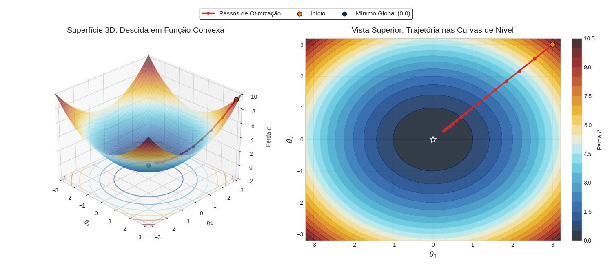
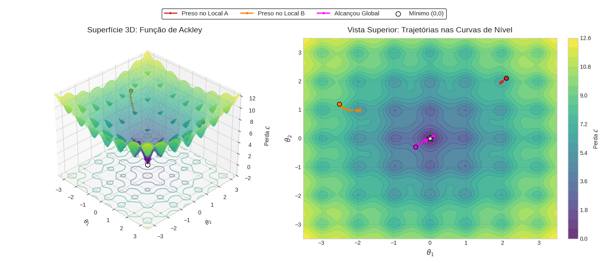

## Sobre a Aula

Esta aula é separada em duas frentes teóricas principais: Redes Neurais e PINNs. Recomenda-se que a leitura dos documentos seja feita na seguinte ordem:
1. Notebook **Aula_Fundamentos_RNN**
2. Arquivo **Aula_PINNsTranscal**
3. Como complemento, as aulas de **Variações de PINNs** e **PINNs aplicadas a MECSOL**

> Nota: A aula de PINNs em MECSOL é do conteúdo de uma disciplina da POSMEC e que foi lecionada com o Prof Dr. Wallace Gusmão em 2025.

## Parte Interativa do tópico de Redes Neurais

### Gradiente Descendente

[Abrir Animação Paraboloide](https://htmlpreview.github.io/?https://github.com/Paulo-de-Souza/HeatTransferPINN/blob/main/Aulas_Notebooks/Aula06/superficie_paraboloide.html)

    

[Abrir Animação Ackley](https://htmlpreview.github.io/?https://github.com/Paulo-de-Souza/HeatTransferPINN/blob/main/Aulas_Notebooks/Aula06/superficie_ackley.html)

    

